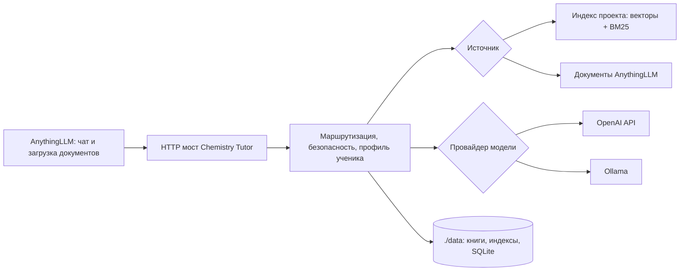

# Roadmap: минимально работающий Chemistry Tutor

Статус: рабочий план, 20 октября 2026 года. Шаги выполняются сверху вниз. Следующий шаг начинается только после проверки результата предыдущего. Документ описывает целевой продукт; команды и интерфейсы, которых ещё нет в коде, ниже названы планируемыми.

## Цель MVP

Пользователь клонирует открытый репозиторий, запускает сервис через Docker Compose, подключает отдельно установленный AnythingLLM как интерфейс чата, выбирает модель, загружает учебник химии и получает ответы с опорой на найденные фрагменты. После остановки и повторного запуска контейнера книга, индексы, история и заметки об учениках сохраняются в `./data`.

Тьютор адаптирует объяснение к уровню ученика, поясняет незнакомые термины, задаёт короткие проверочные вопросы, показывает источник фактов и ограничивает опасные практические инструкции. Можно сравнивать несколько версий учительского промпта. Разработка и регулярные проверки продолжаются на локальной Ollama; основной режим использования с внешней моделью работает через OpenAI API.

### Границы первого выпуска

- Интерфейс чата: AnythingLLM, устанавливаемый пользователем отдельно.
- Генерация: `openai` как целевой провайдер, `ollama` как полноценный режим локальной разработки и тестирования. Провайдеры классификатора, коротких дополнительных вызовов и эмбеддингов настраиваются отдельно. Работа через OpenAI API не должна скрыто требовать запущенную Ollama.
- Поиск: индекс проекта с векторным и BM25 поиском **или** документы, загруженные пользователем в AnythingLLM. Режим источников виден в диагностике и в ответе.
- Корпус: проверенный XHTML учебника *Introductory Chemistry – 1st Canadian Edition*; следующий формат в MVP — PDF с извлекаемым текстом. OCR и произвольные EPUB остаются за границей первого выпуска.
- Хранилище: файлы книги, производные индексы и SQLite внутри одного примонтированного `./data`. Исходную книгу не включаем в Docker образ.
- Работа с учениками: несколько отдельных профилей с уровнем и заметками. До реализации надёжной привязки AnythingLLM к ученику многопользовательский режим нельзя объявлять готовым.

### Схема взаимодействия

AnythingLLM обращается к нашему OpenAI-совместимому HTTP мосту. Мост сам вызывает выбранного провайдера генерации. Ключ OpenAI API хранится только в конфигурации сервиса и не передаётся в AnythingLLM. Ключ моста, который AnythingLLM использует для подключения, — отдельный.

## Исходное состояние и правило работы

В локальной копии уже есть тьюторский граф, HTTP мост, парсер рекомендованной книги, Chroma индекс, SQLite журнал и тесты. Но `src/chemistry_bot/tutor_graph/`, `src/chemistry_bot/integrations/`, связанные тесты и часть зависимостей сейчас не отслеживаются Git. Существующие smoke-тесты используют локальные данные и Ollama. Поэтому первым доказательством готовности будет **свежий клон**, а не запуск только из нынешней рабочей папки.

Текущие незакоммиченные изменения и экспериментальные файлы нужно сначала сохранить и разобрать по назначению. Этапы ниже не предполагают удаления чужой работы или массового переноса файлов одним коммитом.

## Этап 0. Получить воспроизводимую исходную версию

**0.1. Сохранить снимок рабочего состояния.** Зафиксировать `git status`, рабочую ветку, текущие команды запуска и результаты существующих тестов. Отдельно перечислить активный код, экспериментальные материалы и временные патчи. Выход: список файлов с решением «публичный код / документация / локальный архив».

**0.2. Включить активные компоненты в Git.** Добавить тьюторский граф, мост AnythingLLM, их тесты и необходимые файлы зависимостей. Сводки экспериментов разместить в документации или локальном архиве по решению из 0.1. Выход: свежий клон содержит весь код основного сценария.

**0.3. Определить один публичный путь.** Обозначить HTTP мост и тьюторский граф основным продуктовым контуром; прежний CLI RAG бот и Prompt Garden оставить как инструменты разработки. Исправить README, устаревшие команды и несуществующие ссылки. Выход: читатель понимает, что запускать, за несколько минут.

**0.4. Проверить чистый клон.** Установить зависимости в новом окружении без локальной книги и проверить импорт, модульные тесты и запуск `/health`. Зависимость от локального `PYTHONPATH` убрать через установку пакета. Выход: тесты не опираются на скрытые файлы текущего компьютера.

**Ворота этапа:** 0.1 → 0.2 → 0.3 → 0.4. Пока 0.4 не проходит, контейнеризация будет маскировать проблему состава репозитория.

## Этап 1. Разделить логику тьютора и провайдеров моделей

**1.1. Зафиксировать единый контракт вызова модели.** Определить вход: сообщения, роль вызова (`answer`, `classifier`, `followup`), лимиты и идентификатор модели. Определить выход: текст, статус завершения, метаданные и расход токенов, если он доступен. Не переносить политику безопасности в адаптер модели. Выход: граф зависит от контракта, а не от `ChatOllama`.

**1.2. Перевести текущую Ollama на контракт 1.1.** Прокинуть явный `base_url` для работы из контейнера; сохранить текущие локальные проверки. Выход: прежний тьюторский сценарий работает через адаптер Ollama.

**1.3. Добавить адаптер OpenAI API.** Использовать официальный SDK и Responses API для прямых вызовов модели; извлекать текст и метаданные из его ответа, обрабатывать таймауты, лимиты и пустой результат. Версию модели задавать конфигурацией, не зашивать в код. Выход: один и тот же сценарий работает с OpenAI API при наличии ключа.

**1.4. Развязать вспомогательные вызовы.** Классификатор, определение связи реплики, проверочный вопрос и семантические эмбеддинги должны выбирать провайдера явно. Предусмотреть проверенный режим без отдельной малой модели, если он достаточен для локального сценария. Выход: `MODEL_PROVIDER=openai` не вызывает Ollama без явно выбранной локальной функции.

**1.5. Добавить конфигурацию и проверки.** Подготовить `.env.example` без секретов: провайдеры, модели, URL, лимиты токенов, таймауты, предел расходов и диагностика. Модульные тесты используют поддельный адаптер; сетевые проверки Ollama и OpenAI включаются отдельно. Выход: понятные ошибки настройки без скрытой смены провайдера.

**Ворота этапа:** 1.1 → 1.2 → 1.3 → 1.4 → 1.5. Локальные тесты Ollama остаются обязательными после добавления OpenAI.

## Этап 2. Запуск одной командой и сохранение данных

**2.1. Подготовить устанавливаемый пакет и зависимости контейнера.** Отделить серверные зависимости от инструментов Prompt Garden и платформенного CUDA PyTorch. Выход: Linux образ собирается без локальных Windows путей.

**2.2. Добавить Dockerfile и Compose.** Контейнер запускает HTTP мост, открывает `/health`, принимает конфигурацию из окружения и монтирует `./data`. Указать адрес хостовой Ollama для локальных тестов. Выход: `docker compose up --build` запускает сервис на чистой машине.

**2.3. Проверить сохранность.** Создать тестового ученика и небольшой файл-маркер в `./data`, остановить и пересоздать контейнер, убедиться, что SQLite и файл сохранились. Проверку реального книжного индекса выполнить после 4.4. Добавить резервное копирование как простую инструкцию для `./data`. Выход: пересоздание контейнера не стирает данные.

**2.4. Добавить проверку готовности.** Отдельно показывать состояние HTTP сервиса, базы, выбранного провайдера модели и индекса. Не считать `/health` доказательством доступности OpenAI или Ollama, если он проверяет только процесс. Выход: при ошибке пользователь видит конкретный недоступный компонент.

**Ворота этапа:** 2.1 → 2.2 → 2.3 → 2.4.

## Этап 3. Проверить настоящий AnythingLLM

**3.1. Закрепить поддерживаемую версию и способ установки AnythingLLM.** Отдельно описать адрес моста для AnythingLLM Desktop и AnythingLLM в Docker. Подготовить короткую настройку Generic OpenAI: URL, ключ моста и модель `chemistry-tutor`. Выход: подключение занимает несколько понятных действий.

**3.2. Снять реальные запросы двух режимов.** Проверить обычный чат с документом и режим, где AnythingLLM вызывает `rag-memory`; сравнить фактические сообщения, инструменты и метаданные. Выход: интеграция опирается на зафиксированные реальные запросы, а не только на имитации в тестах.

**3.3. Довести цикл документа до ответа.** Пользователь загружает книгу только в интерфейсе AnythingLLM, задаёт вопрос, мост получает подходящий фрагмент и возвращает ответ тьютора с названием источника. Нерелевантный фрагмент не выдаётся за подтверждение факта. Выход: этот путь работает без запуска нашего `ingest`.

**3.4. Добавить сквозной тест и диагностику подключения.** Проверить прямой ответ, поиск по документу, отсутствие подходящего фрагмента и опасный запрос. Автоматизация через API AnythingLLM допускается после подтверждения его возможностей и получения пользователем собственного API ключа; ручная настройка остаётся рабочим вариантом. Выход: одна инструкция и один проверочный сценарий повторяют опыт пользователя.

**Ворота этапа:** 3.1 → 3.2 → 3.3 → 3.4. Нельзя заявлять поддержку RAG AnythingLLM по одним модульным тестам моста.

## Этап 4. Автоматическая загрузка книг в проект

**4.1. Описать контракт корпуса.** Принять файл или папку, сохранить исходник, имя книги, лицензию/происхождение, контрольную сумму и статус обработки. Определить ошибки неподдерживаемого формата. Выход: импорт не зависит от одного жёстко заданного имени файла.

**4.2. Превратить существующий XHTML пайплайн в `ingest`.** Для рекомендованной книги автоматически получить главы, разделы и чанки, сохраняя устойчивые идентификаторы и указатели на раздел. Добавить ссылку на [официальную страницу книги](https://opentextbc.ca/introductorychemistry/) и инструкцию скачивания XHTML. Выход: один импорт создаёт пригодный корпус без ручного запуска трёх скриптов.

**4.3. Добавить текстовый PDF и несколько книг.** Проверять, что текст действительно извлечён; пустой или сканированный PDF получает ясную ошибку. Разделять книги по идентификаторам. Выход: пользователь может добавить вторую книгу, не затерев первую.

**4.4. Построить оба индекса.** Векторный индекс и BM25 (например, через SQLite FTS5) строятся из одних чанков; результаты объединяются с ограничением дублей и сохраняют источник. Провайдер эмбеддингов выбирается отдельно: OpenAI API или локальная Ollama. При смене модели эмбеддингов индекс перестраивается явно. Остановить и пересоздать контейнер с готовыми индексами. Выход: поиск работает после перезапуска и не смешивает несовместимые векторы.

**4.5. Подключить поиск к HTTP тьютору.** Ввести явный режим источника: индекс проекта, документы AnythingLLM, автоматический выбор. Для ответа по названной книге сохранять её приоритет и отказывать в фиктивной ссылке при слабых находках. Выход: пользователь получает фрагмент именно из выбранной книги и может открыть его источник.

**4.6. Проверить качество на фиксированных вопросах.** Включить определения, формулы, редкие термины, вопросы с несколькими книгами и случаи «в книге нет ответа». Сравнить векторный поиск, BM25 и их объединение. Выход: качество измеряется на одинаковых вопросах до и после изменений.

**Ворота этапа:** 4.1 → 4.2 → 4.3 → 4.4 → 4.5 → 4.6.

## Этап 5. Журнал ученика и варианты учителя

**5.1. Разрешить привязку диалога к ученику.** Проверить, передаёт ли поддерживаемый AnythingLLM устойчивый идентификатор в реальном запросе. Если нет, выбрать явный способ выбора ученика для локального оператора и зафиксировать его границы. Не выводить личность ученика из сходства текста диалогов. Выход: два ученика не могут случайно разделить одну историю.

**5.2. Добавить минимальный профиль.** Сохранить уровень/класс, язык, предпочтительную длину объяснения и редактируемые заметки. Отделить заметки педагога от автоматически предложенных наблюдений. Выход: после перезапуска профиль остаётся, его можно просмотреть и исправить.

**5.3. Реализовать один устойчивый тьюторский цикл.** Ответ объясняет нужное слово на уровне ученика, опирается на найденный раздел и при уместности задаёт один проверочный вопрос. Следующая реплика учитывает ответ ученика и обновляет заметку только по явному правилу. Выход: демонстрация двух последовательных реплик показывает обучение, а не только справочный ответ.

**5.4. Добавить 2–3 версии личности.** Хранить версионированные учительские промпты и выбранный ID в журнале ответа. Prompt Garden использовать для сравнения вариантов, не подключая весь интерфейс экспериментов к пути обычного пользователя. Выход: одинаковый вопрос можно сравнить на одной модели и одном корпусе, видя использованную версию промпта.

**Ворота этапа:** 5.1 → 5.2 → 5.3 → 5.4.

## Этап 6. Защита, выпуск и проверка свежего клона

**6.1. Проверить входные ограничения.** Собрать набор школьных вопросов и запросов на опасные химические процедуры на английском, русском и украинском. Измерить пропуски и ложные блокировки. Защитное решение принимается до поиска и вызова внешней модели. Выход: известные опасные запросы не получают практических инструкций.

**6.2. Проверить выход и документы.** Удалять практические опасные детали из готового ответа, проверять подмену инструкций в загруженной книге и не превращать найденный текст в команду для тьютора. Выход: источник остаётся источником фактов, а не управляющим промптом.

**6.3. Завершить пользовательскую инструкцию.** Один README ведёт через клонирование, Compose, подключение AnythingLLM, выбор OpenAI API или Ollama, загрузку книги, проверку ответа и поиск файлов данных. Указать, что ключ OpenAI API создаётся отдельно и что его расход контролируется настройками сервиса. Выход: настройка не требует чтения экспериментальных PR сводок.

**6.4. Провести выпускную проверку из свежего клона.** Пройти два маршрута: (а) OpenAI API + индекс проекта, (б) Ollama + документ в AnythingLLM. Перезапустить контейнер и проверить сохранность базы и обоих индексов. Зафиксировать версии, результаты и ограничения первого выпуска. Выход: каждый заявленный пользовательский сценарий воспроизводится по README.

**Ворота этапа:** 6.1 → 6.2 → 6.3 → 6.4. MVP готов, когда проходит 6.4; дальнейшие функции не расширяют этот критерий задним числом.

## Что не задерживает MVP

OCR сканов, автоматическое скачивание чужих учебников, тонкая модель оценки освоения каждой темы, самостоятельное изменение промптов моделью, полная миграция Prompt Garden в SQL и поддержка любого OpenAI-совместимого сервера сверх проверенных OpenAI API и Ollama. После первого выпуска эти задачи можно выбирать по результатам реальных вопросов и тестов.

## Полезные источники

- [OpenAI Docs: генерация текста через Responses API](https://developers.openai.com/api/docs/guides/text) — основа адаптера OpenAI; модель задаётся конфигурацией.
- [AnythingLLM: API и ключи](https://docs.anythingllm.com/features/api) — возможности автоматизации рабочих пространств и документов.
- [AnythingLLM: Docker инструкция](https://github.com/Mintplex-Labs/anything-llm/blob/master/docker/HOW_TO_USE_DOCKER.md) — адреса сервисов и сохранение данных при контейнерном запуске.
- [Официальная страница рекомендуемой книги](https://opentextbc.ca/introductorychemistry/) — XHTML и условия распространения.
